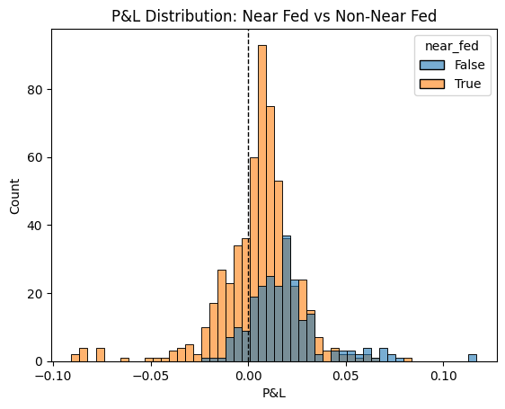
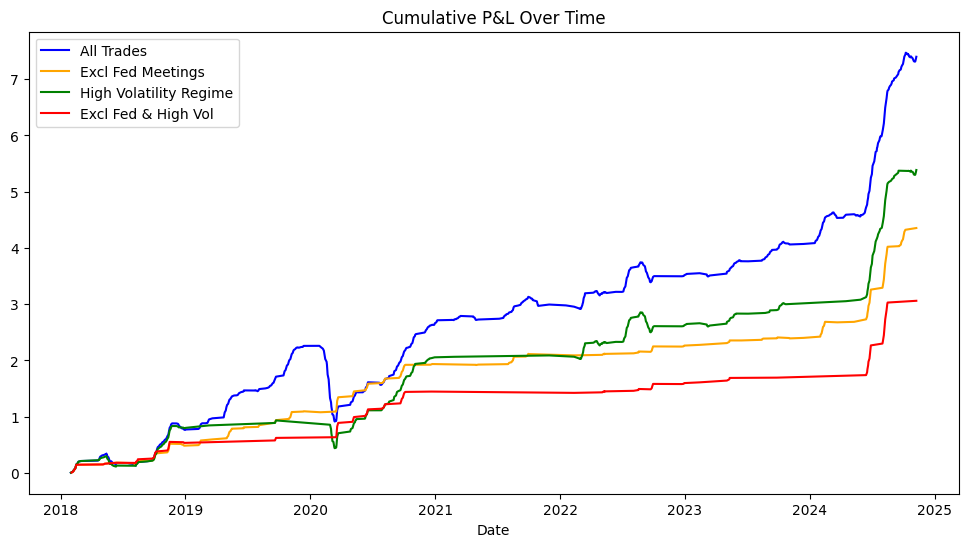

# EUR/USD variance risk premium: continuous premium or event risk?

Implied volatility on EUR/USD usually sits above the volatility that is later realised, so selling vol earns a premium. This project asks **what that premium is paying for**. If it compensates for continuous exposure, a short-vol book should run all the time. If it compensates mainly for scheduled event risk, the book should be gated on the central bank calendar.

Independent project, March to April 2026. Full write-up: [`report/FX_VRP_Report.pdf`](report/FX_VRP_Report.pdf). Code and outputs: [`fx_vrp_analysis.ipynb`](fx_vrp_analysis.ipynb).

## Setup

- **Data:** daily EUR/USD and the EVZ implied vol index from Yahoo Finance, 2018 to 2024.
- **Realised vol (RV):** 21-day rolling standard deviation of log returns, × √252.
- **VRP:** EVZ/100 − RV.
- **Trade rule:** on any day the VRP is above its mean, sell one month of implied vol. Trade P&L is IV at entry minus RV over the next 21 trading days, in vol points.
- **Event flags:** whether an FOMC (or ECB) meeting falls inside the 30 calendar days after entry.

That gives 820 entry days, of which 807 have a complete 21-day window to score.

## Findings

**1. Fed meetings inside the holding window take most of the premium.** Mean P&L is 0.0188 for trades with no FOMC meeting in the window and 0.0053 for trades with one. Daily entries with 21-day holds overlap, so the trades are not independent: a naive Welch t-test gives t = −8.69, but the Durbin-Watson statistic is 0.31. With Newey-West HAC errors (21 lags, matching the overlap) the effect is −0.0136 (t = −3.72, p < 0.001). Still significant, but less than half the naive t-stat.

**2. ECB meetings make no significant difference** (coefficient −0.0023, p = 0.52). A plausible reading is that EUR/USD vol is driven mainly by dollar liquidity, which the Fed moves. So the filter uses Fed dates only, because adding ECB dates would cut trades without improving risk-adjusted return.

**3. The premium is larger in high-vol regimes** (IV above its median: 0.0136 against 0.0049, p = 0.017), but so are the worst losses.

**4. Excluding Fed windows removes most of the tail.**

| Strategy | Trades | Mean P&L | Annualised Sharpe* | 5% CVaR |
|---|---:|---:|---:|---:|
| All signals | 820 | 0.0092 | 1.50 | −0.0433 |
| Excluding Fed windows | 238 | 0.0188 | 3.28 | −0.0111 |
| High-vol regime only | 406 | 0.0136 | 1.98 | −0.0395 |
| Excluding Fed + high vol | 132 | 0.0245 | 3.64 | −0.0084 |

Excluding Fed windows cuts 5% CVaR by 74%, while the high-vol filter alone barely moves it. **The tail risk comes from event exposure.**

\*Per-trade mean/std × √(252/21). Trade counts are entry signals, including the 13 at the end of the sample with no complete window.

| Fed vs non-Fed trade P&L | Cumulative P&L by strategy |
|---|---|
|  |  |

## Limitations

These are the things I would fix before trusting any of the numbers above with money.

- **Look-ahead:** the entry threshold (mean VRP) and the vol-regime cut-off (median IV) use full-sample statistics. A live version needs expanding or rolling estimates.
- **No transaction costs.** Bid-ask on EUR/USD one-month vol is roughly 0.2 to 0.5 vol points, which is large next to a 0.009 mean P&L. The filtered strategies are hurt least, because they trade less and earn more per trade.
- **Selection:** four variants were compared on the same sample, so the best Sharpe is optimistic. The Fed filter has an economic reason behind it. The combined filter is closer to a fitted result.
- **Overlap:** trades overlap heavily. The Newey-West errors handle inference, but the Sharpe convention above treats trades as monthly bets, so use it to compare variants. It is not an achievable figure.
- **P&L definition:** IV minus realised vol behaves like a volatility swap. A delta-hedged straddle earns roughly ½Γ(σ²_implied − σ²_realised) day by day, so its P&L depends on the path and is in variance terms. The two are close but not identical.
- **One pair, one sample:** the Fed result may not carry over. USD/JPY, with its sensitivity to US rate differentials, is the natural next test.

## Run it

```bash
pip install -r requirements.txt
jupyter notebook fx_vrp_analysis.ipynb
```

The notebook downloads data with `yfinance`. Yahoo sometimes revises its history, so a fresh run can differ slightly from the saved outputs (run in April 2026).
